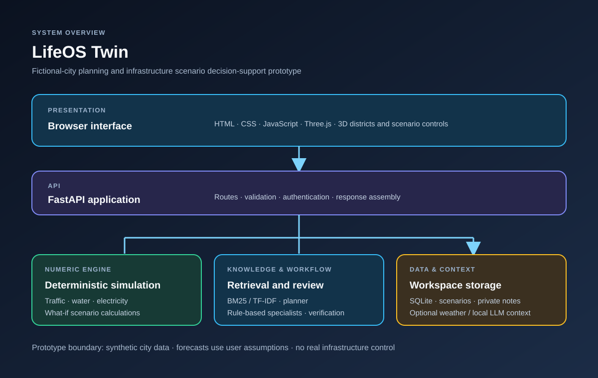

# LifeOS Twin

**A city-planning decision-support prototype with an interactive 3D interface, scenario simulation, evidence retrieval and rule-based specialist analysis.**

LifeOS Twin models a fictional city called **Nova City**. Users can inspect districts, change planning assumptions, compare possible interventions and review modeled changes in traffic, water demand and electricity demand.



> **Project status:** Experimental prototype. City districts and infrastructure indicators are synthetic. This is not a live city digital twin, a validated forecasting system or an infrastructure control platform.

## Main features

- Interactive 3D city and district overview using Three.js.
- FastAPI backend with deterministic traffic, water and electricity scenario calculations.
- What-if scenario comparison and assumption-based forecasting.
- Transparent weighted decision scoring and three deterministic specialist reviewers.
- Knowledge retrieval over a synthetic planning corpus.
- Authenticated private workspaces, saved scenarios and private notes.
- Optional Open-Meteo weather context, kept separate from infrastructure calculations.
- User-supplied infrastructure observation intake with basic validation.
- Investigation verification, audit details and PDF reporting.

## Technology

- **Frontend:** HTML, CSS, JavaScript, Three.js
- **Backend:** Python, FastAPI
- **Data:** SQLite, JSON
- **Testing:** pytest

## Architecture

See [the architecture diagram](docs/architecture.svg) and [system architecture notes](docs/architecture.md).

## Run locally

Requirements: Python 3.11+ and a modern browser.

1. Open a terminal in `backend/`.
2. Install dependencies:

   ```bash
   pip install -r requirements.txt
   ```

3. Start the API:

   ```bash
   uvicorn app.main:app --reload
   ```

4. Open `frontend/index.html` in a browser.

The frontend expects the API at `http://127.0.0.1:8000` by default. Three.js is loaded from jsDelivr, so the browser needs internet access for the 3D scene. API-backed features require the backend.

## Validation

Run the backend test suite from `backend/`:

```bash
pytest -q
```

The consolidated project package reports **120 passing backend tests**. These tests do not constitute browser visual testing, a production security audit or real-world model validation.

## Important limitations

- Nova City and its infrastructure baselines are synthetic.
- Decision scores are prototype heuristics, not engineering recommendations.
- Specialist reviewers are deterministic Python logic, not autonomous LLM agents.
- Forecasts use user-entered compound growth assumptions; no historical training data is used.
- Weather data is contextual only and does not change infrastructure calculations.
- Imported infrastructure observations are user supplied, receive basic validation, are held in memory and are not connected to simulation calculations.
- GitHub Pages can host the static frontend only; the FastAPI backend needs separate hosting.
- The application is not ready for production or real municipal decision-making.

## Documentation

- [System architecture](docs/architecture.md)
- [Knowledge engine](docs/knowledge-engine.md)
- [Private workspaces and authentication](docs/authentication-and-workspaces.md)
- [Decision intelligence](docs/decision-intelligence.md)
- [Specialist debate](docs/multi-agent-debate.md)
- [Scenario exploration](docs/scenario-intelligence.md)
- [Forecasting assumptions](docs/predictive-forecasting.md)
- [External data integration](docs/external-data-integration.md)
- [Infrastructure data ingestion](docs/infrastructure-data-ingestion.md)
- [Investigation audit and PDF export](docs/investigation-audit-export.md)
- [Resume-ready project summary](docs/resume-description.md)
